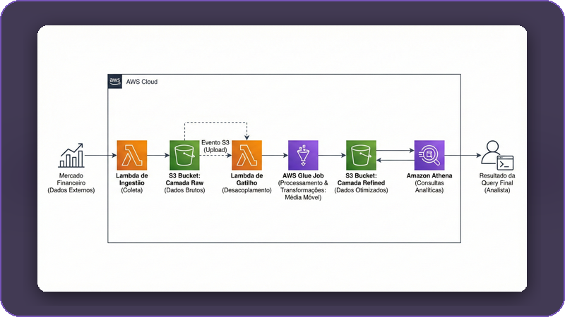
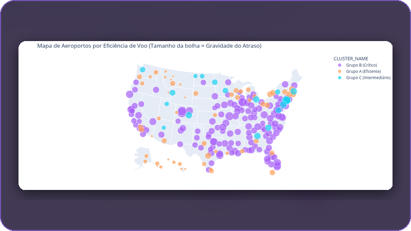
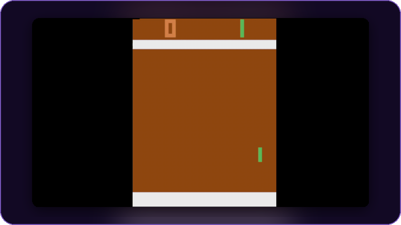
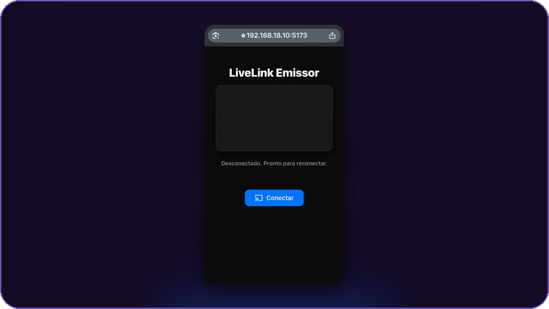
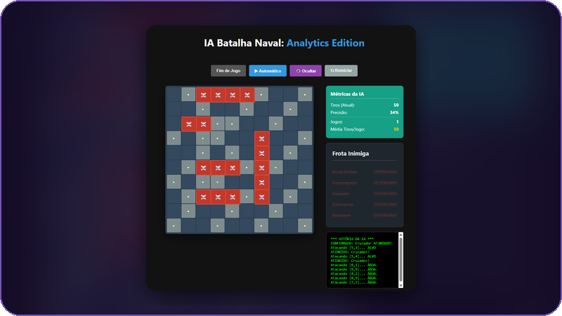

 

<table>
<tr>
<td width="62%" valign="top">

### 👨‍💻 Sobre mim

Engenheiro de **Machine Learning e Dados** em São Paulo, com pós em **ML Engineering pela FIAP** e formação em Gestão de TI.

Gosto de levar dados e modelos **até o uso real**: pipelines na AWS, modelos servidos por API e experimentos rastreados no MLflow.
E também construo e mantenho sistemas que **rodam em produção todos os dias** — como o ERP da gráfica onde trabalho.

</td>
<td width="38%" valign="top">

### ⚡ Em resumo

- 🧠 ML, MLOps e validação sem vazamento
- ☁️ Pipelines serverless na AWS
- 🏭 Software em produção com usuário real
- 🌎 PT nativo · EN · ES intermediário

</td>
</tr>
</table>

---

## ⭐ Em produção

<a href="https://github.com/ErosNicolino/ctrl-suite"><b>CTRL Suite</b></a> — ERP, orçamento de impressão 3D e controle de ponto que substituíram o papel na parede e a planilha de uma gráfica rápida. 
<code>C#</code> <code>.NET 10 WPF</code> <code>Python</code> <code>SQLite</code> <code>PWA</code>

---

## 📊 Dados e Machine Learning

<table>
<tr>
<td width="50%" valign="top">

<h3><a href="https://github.com/ErosNicolino/Serverless-Financial-Data-Pipeline-on-AWS">Financial Data Pipeline</a></h3>
ETL da B3 orientado a eventos, do dado bruto à consulta analítica, sem servidor ocioso.  
<code>AWS Glue</code> <code>Lambda</code> <code>S3</code> <code>Athena</code>
</td>
<td width="50%" valign="top">

<h3><a href="https://github.com/ErosNicolino/datathon-7mlet">Recomendação Adaptativa</a></h3>
Prioriza a próxima melhor oferta com multi-armed bandits — <b>66,34%</b> de conversão simulada.  
<code>Thompson Sampling</code> <code>FastAPI</code> <code>MLflow</code>
</td>
</tr>
<tr>
<td width="50%" valign="top">

<h3><a href="https://github.com/ErosNicolino/AeroPredict-ML">AeroPredict</a></h3>
Predição de atrasos aéreos com validação estratificada, clusterização e zero vazamento de dados.  
<code>Scikit-learn</code> <code>K-Means</code> <code>Pandas</code>
</td>
<td width="50%" valign="top">

<h3><a href="https://github.com/ErosNicolino/PongAI">Pong AI</a></h3>
Agente PPO que aprende a jogar Pong direto dos pixels, treinado por 2 milhões de passos.  
<code>PPO</code> <code>Stable-Baselines3</code> <code>PyTorch</code>
</td>
</tr>
</table>

➕ <a href="https://github.com/ErosNicolino/stock-lstm-prediction"><b>Stock LSTM</b></a> — previsão de preço de ações com LSTM, servida por FastAPI em Docker.

---

## 🛠️ Apps e backend

<table>
<tr>
<td width="50%" valign="top">

<h3><a href="https://github.com/ErosNicolino/LiveLink-WebRTC">LiveLink</a></h3>
O celular vira webcam sem fio para o PC, P2P em tempo real com latência abaixo de 300 ms.  
<code>WebRTC</code> <code>React</code> <code>Node.js</code> <code>Socket.io</code>
</td>
<td width="50%" valign="top">

<h3><a href="https://github.com/ErosNicolino/Ifood_Manager">iFood Manager</a></h3>
App desktop de gestão financeira para entregadores, com indicadores e rentabilidade por bairro.  
<code>Tauri</code> <code>Rust</code> <code>React</code> <code>SQLite</code>
</td>
</tr>
<tr>
<td width="50%" valign="top">

<h3><a href="https://github.com/ErosNicolino/battleship-probabilistic-ai">Batalha Naval IA</a> · <a href="https://battleship-probabilistic-ai.vercel.app">demo ↗</a></h3>
IA que escolhe cada tiro por mapa de probabilidade e heurísticas.  
<code>React</code> <code>Vite</code> <code>Probabilidade</code>
</td>
<td width="50%" valign="top">

<h3><a href="https://github.com/ErosNicolino/tech-challenge-books-api">Books API</a> · <a href="https://tech-challenge-books-api-mkqn.onrender.com">demo ↗</a></h3>
API REST documentada com scraping automatizado, autenticação JWT e contêiner.  
<code>Flask</code> <code>Docker</code> <code>Swagger</code> <code>JWT</code>
</td>
</tr>
</table>

---

## 🧰 Tecnologias

**Dados e ML**  

**Cloud e produção**  

**Aplicações**  

 

