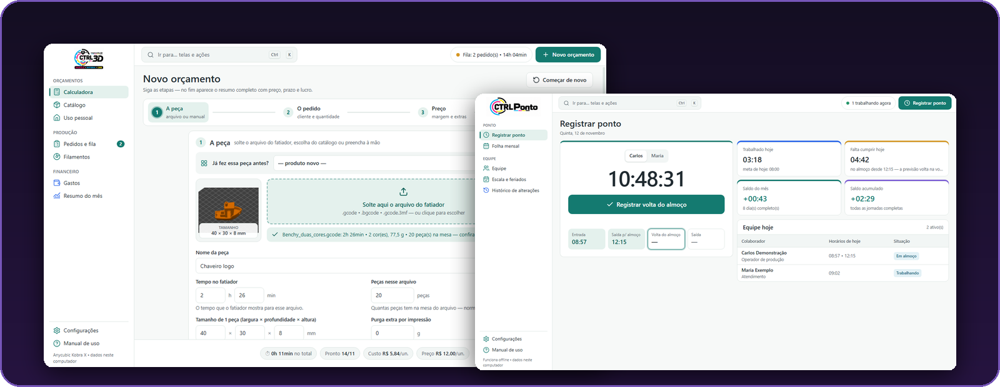
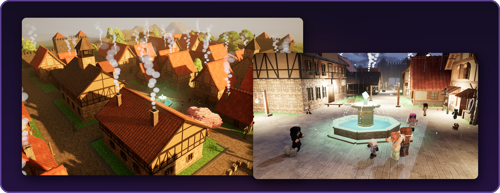
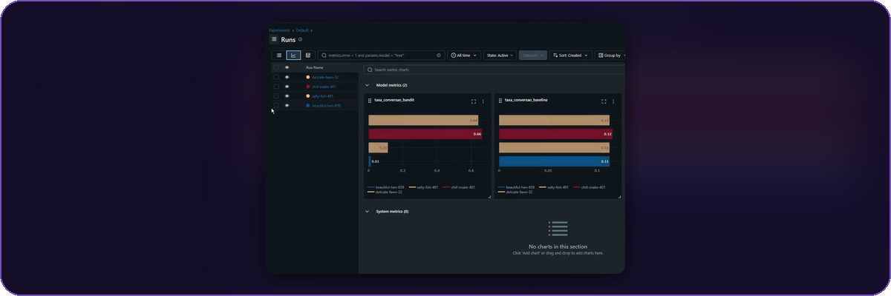
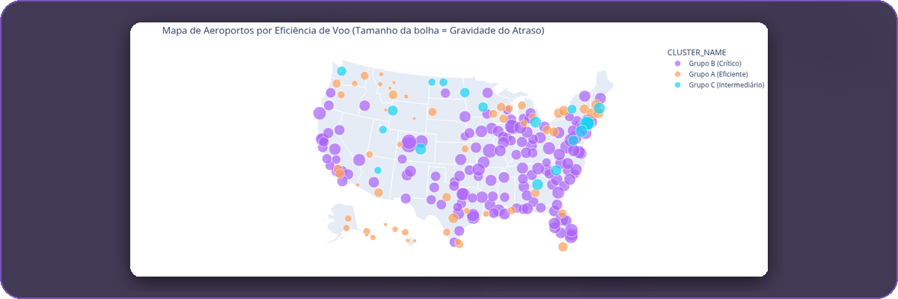

<picture>
  <source media="(max-width: 700px)" srcset="assets/header-celular.svg"/>
  
</picture>

### 👨‍💻 Sobre mim

Engenheiro de **Machine Learning e Dados** em São Paulo, com pós em **ML Engineering pela FIAP** e formação em Gestão de TI.
Gosto de levar dados e modelos **até o uso real** — pipelines na AWS, modelos servidos por API e experimentos rastreados no MLflow —
e também construo e mantenho sistemas que **rodam em produção todos os dias**, como o ERP da gráfica onde trabalho.

> 🧠 ML e MLOps &nbsp;·&nbsp; ☁️ Pipelines na AWS &nbsp;·&nbsp; 🏭 Software em produção &nbsp;·&nbsp; 🌎 PT · EN · ES

---

## ⭐ Em produção

**[CTRL Suite](https://github.com/ErosNicolino/ctrl-suite)** — ERP, orçamento de impressão 3D e controle de ponto que substituíram o papel na parede e a planilha de uma gráfica rápida. 
`C#` `.NET 10 WPF` `Python` `SQLite` `PWA`

<picture>
  <source media="(max-width: 700px)" srcset="assets/numeros-celular.svg"/>
  
</picture>

---

## 🎮 Jogos

**[The World Gêneses](https://eros-nicolino.itch.io/the-world-geneses)** · [trailer ▶](assets/geneses-trailer.mp4) — RPG de mundo aberto em blocos, solo ou com amigos: nove regiões, seis raças, chefes com fases, vilas com moradores de rotina própria, clima e estações. Migrado do Godot para a Unreal Engine 5.8, com ~74 mil linhas de C++. 
`Unreal Engine 5` `C++` `Multiplayer (EOS)` `Gameplay Ability System` `Blender`

---

## 📊 Dados e Machine Learning

**[Financial Data Pipeline](https://github.com/ErosNicolino/Serverless-Financial-Data-Pipeline-on-AWS)** — ETL da B3 orientado a eventos, do dado bruto à consulta analítica, sem servidor ocioso. 
`AWS Glue` `Lambda` `S3` `Athena`

**[Recomendação Adaptativa](https://github.com/ErosNicolino/datathon-7mlet)** — prioriza a próxima melhor oferta com multi-armed bandits: **66,34%** de conversão simulada. 
`Thompson Sampling` `FastAPI` `MLflow`

**[AeroPredict](https://github.com/ErosNicolino/AeroPredict-ML)** — predição de atrasos aéreos com validação estratificada, clusterização e zero vazamento de dados. 
`Scikit-learn` `K-Means` `Pandas`

**[Pong AI](https://github.com/ErosNicolino/PongAI)** — agente PPO que aprende a jogar Pong direto dos pixels, treinado por 2 milhões de passos. 
`PPO` `Stable-Baselines3` `PyTorch`

➕ **[Stock LSTM](https://github.com/ErosNicolino/stock-lstm-prediction)** — previsão de preço de ações com LSTM, servida por FastAPI em Docker.

---

## 🛠️ Apps e backend

**[LiveLink](https://github.com/ErosNicolino/LiveLink-WebRTC)** — o celular vira webcam sem fio para o PC, P2P em tempo real com latência abaixo de 300 ms. 
`WebRTC` `React` `Node.js` `Socket.io`

**[iFood Manager](https://github.com/ErosNicolino/Ifood_Manager)** — app desktop de gestão financeira para entregadores, com indicadores e rentabilidade por bairro. 
`Tauri` `Rust` `React` `SQLite`

**[Batalha Naval IA](https://github.com/ErosNicolino/battleship-probabilistic-ai)** · [demo ↗](https://battleship-probabilistic-ai.vercel.app) — IA que escolhe cada tiro por mapa de probabilidade e heurísticas. 
`React` `Vite` `Probabilidade`

**[Books API](https://github.com/ErosNicolino/tech-challenge-books-api)** · [demo ↗](https://tech-challenge-books-api-mkqn.onrender.com) — API REST documentada com scraping automatizado, autenticação JWT e contêiner. 
`Flask` `Docker` `Swagger` `JWT`

---

## 🧰 Tecnologias

**Dados e ML**  

**Cloud e produção**  

**Aplicações**  

**Jogos**  

 

